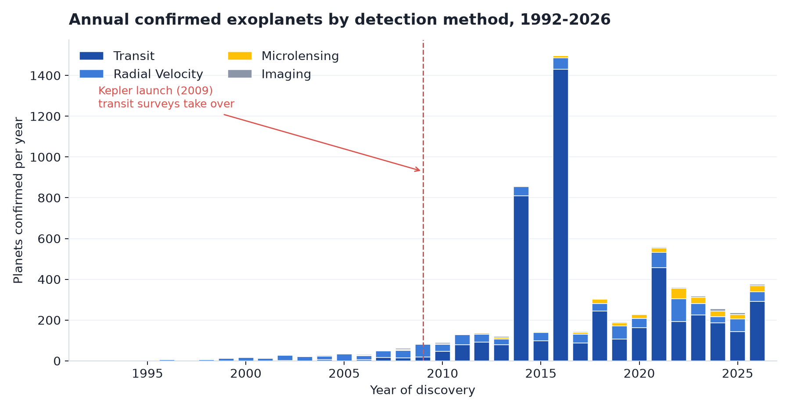
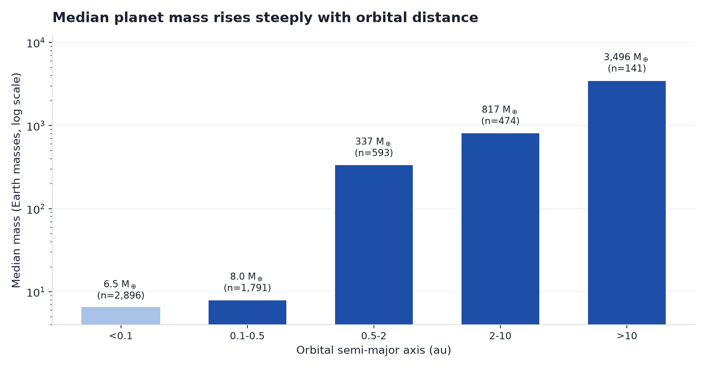
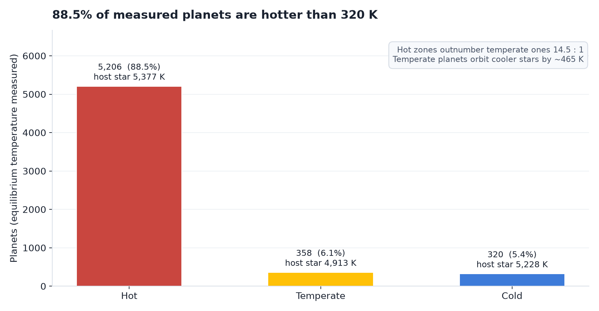

# Exoplanet Population Analysis

**What 6,412 confirmed planets can — and cannot — tell us about habitability**

An end-to-end exploratory analysis of the NASA Exoplanet Archive, from raw archive export to cleaned dataset, three independent findings, and a presentation deck.

> *An exploratory data analysis of 6,412 confirmed exoplanets. Each of the three findings is derived from a different pair of variables, and each is framed as a statement about what our instruments can detect rather than about what exists.*

---

## 30 秒速览

| | |
|---|---|
| **数据** | NASA Exoplanet Archive · PSCompPars，2026-11-15 快照，6,470 行 × 84 列 |
| **清洗** | 剔除 58 颗争议行星 → **6,412 颗 × 15 个变量**，重复 0，缺失值保留并说明 |
| **方法** | pandas 清洗与分组聚合 · 分箱统计（中位数抗极端值）· matplotlib 可视化 · Excel 交叉校验 |
| **产出** | 3 个互不重叠的洞察 + 3 张图 + 1 份 9 页英文演示 |
| **结论** | 样本的"样子"主要由**探测手段**决定，宜居性判断必须先校正观测偏差 |

核心结论一句话：**这个星表记录的是望远镜能发现什么，而不是宇宙里有什么。** 88.5% 的行星比 320 K 更热，不是因为宇宙偏爱热行星，而是因为短周期大质量行星最容易产生可测信号。

---

## 目录

- [为什么做这个分析](#为什么做这个分析)
- [数据来源与清洗](#数据来源与清洗)
- [三个发现](#三个发现)
- [综合结论与建议](#综合结论与建议)
- [局限性](#局限性)
- [仓库结构](#仓库结构)
- [复现方式](#复现方式)
- [技能清单](#技能清单)

---

## 为什么做这个分析

系外行星几乎无法被直接看到。凌星法（transit）测的是行星掠过恒星表面时亮度下降的幅度，视向速度法（radial velocity）测的是恒星被行星拉动产生的光谱摆动。两种信号都随轨道距离衰减——**离得越远、行星越小，越测不到**。

这意味着任何一份"已确认行星"目录都是被探测能力筛过的样本。如果直接对这份目录做统计就下结论，很容易把"仪器升级"误读成"行星族群演化"，把"观测偏好"误读成"物理规律"。

这个分析的出发点就是：**先承认样本偏差，再谈行星本身。**

## 数据来源与清洗

**来源**：NASA Exoplanet Archive — Planetary Systems Composite Parameters (PSCompPars)，Caltech/IPAC-NExScI。2026-11-15 导出，文件头含 88 行 `#` 元数据注释。

| 步骤 | 处理 | 结果 |
|---|---|---|
| 1 | 跳过 `#` 注释头，解析 84 列 | 6,470 行 × 84 列 |
| 2 | 剔除 `pl_controv_flag = 1` 的争议行星 | −58 行 |
| 3 | 只保留 14 个分析相关变量，去掉不确定度区间列 | 84 → 14 列 |
| 4 | 派生 `Temp_Zone`（Hot / Temperate / Cold，基于平衡温度） | 15 列 |
| 5 | 重名检查 | 6,412 个行星名，**重复 0** |

**缺失值策略**：不删除缺失行，只在实际用到该变量时才过滤。这样每种统计的分母都不同，但都不会因为删行而扭曲探测方法的构成。

| 变量 | 缺失数 | 缺失占比 | 处理 |
|---|---|---|---|
| `pl_eqt` 平衡温度 | 528 | 8.2% | 保留行，仅在温度分析中排除 |
| `pl_orbsmax` 轨道半长轴 | 493 | 7.7% | 保留行，仅在质量-轨道分析中排除 |
| `pl_bmasse` 行星质量 | 26 | 0.4% | 同上 |
| `pl_rade` 行星半径 | 44 | 0.7% | 本分析未使用 |

## 三个发现

三个问题刻意使用**不同的变量对**和**不同的图表**，保证结论互相独立，避免同一组数据被反复"榨出"三个说法。

### 1 · 样本构成跟着仪器变，不跟着行星变



1992–2008 年，四种主要探测手段共记录 310 颗行星，其中视向速度贡献 243 颗，凌星法只有 42 颗（**13.5%**）。2009 年开普勒升空后，凌星法在 2010 年之后的年度占比平均达到 **69.7%**，并在 2014 年（861 颗）和 2016 年（1,499 颗）出现批量化发布的高峰。微透镜与直接成像合计贡献 388 颗，多分布在更宽的轨道上。

**解读**：这是探测能力的更替，不是行星形成机制的变化。

**建议**：比较不同年代的数据时，先按探测方法分层，再在层内比较。否则一次巡天设备升级就会被误读成天体物理趋势。

### 2 · 行星质量随轨道距离陡升，540 倍



在同时有质量和轨道距离的 **5,895 颗**行星中，**79.5%** 位于 0.5 au 以内。但质量中位数随距离急剧上升：

| 轨道半长轴 | 行星数 | 中位质量（地球质量） | 中位周期（天） |
|---|---:|---:|---:|
| < 0.1 au | 2,896 | 6.5 | 4.5 |
| 0.1 – 0.5 au | 1,791 | 8.0 | 25.5 |
| 0.5 – 2 au | 593 | 337.2 | 358 |
| 2 – 10 au | 474 | 816.8 | 2,278 |
| > 10 au | 141 | **3,496** | 20,608 |

从最近一档到最远一档，中位质量上升约 **540 倍**。距离最近的一档里仍有 **692 颗**行星质量超过 100 个地球质量——这就是热木星。

**解读**：这个梯度同时包含真实的轨道迁移效应和强烈的探测偏好（近距离、大质量更容易被发现），两者无法用这份数据完全分离。

**建议**：把近距离巨行星作为大气光谱观测的优先目标；但任何关于"质量分布"的陈述都必须先按探测完备度加权。

### 3 · 88.5% 的已测行星比 320 K 更热



在有平衡温度（`pl_eqt`）的 **5,884 颗**行星中：

| 温度分区 | 行星数 | 占比 | 宿主恒星平均温度 |
|---|---:|---:|---:|
| 热（> 320 K） | 5,206 | 88.5% | 5,377 K |
| 温带（200–320 K） | 358 | 6.1% | **4,913 K** |
| 冷（< 200 K） | 320 | 5.4% | 5,228 K |

热行星数量是温带行星的 **14.5 倍**。更有意思的是宿主恒星：温带行星的宿主比热行星的宿主平均**低 465 K**。

**解读**：一半是短轨道更容易被探测的效应，一半是真实物理——同样的平衡温度，在更暗的恒星周围对应更近的轨道，因此更容易被凌星法捕捉。这与"宜居带在冷恒星周围更靠近恒星"一致。

**建议**：冷 K 型和 M 型矮星是温带行星后续观测的高效目标。

## 综合结论与建议

三条发现串成一条逻辑链：

> **仪器变了 → 样本变了 → 才轮到物理解释。**

1. **先控制仪器**：按探测方法分层比较，不要跨方法直接比年代趋势。
2. **再校正距离**：按探测完备度加权，再描述质量分布。
3. **最后谈宜居性**：优先观测冷矮星周围的温带行星，且必须清楚平衡温度不等于气候。

## 局限性

四条限制都写进了分析本身，而不是事后补一段免责声明：

1. **温度缺失 528 行**——这些行被保留而非删除，否则会连带扭曲探测方法的计数。
2. **`pl_bmasse` 是下限**——视向速度法给的是 M sin i，质量是下界而非真值。因此全部用分箱中位数而不用均值，降低极端值的拉动。
3. **平衡温度不是表面温度**——`pl_eqt` 假设零反照率、无大气；真正的宜居性判断需要这份表里没有的光谱数据。
4. **发现年份 ≠ 确认年份**——2014 与 2016 的尖峰来自开普勒的批量目录发布，不代表那两年真的发现了更多行星。

## 仓库结构

```
.
├── data/
│   ├── exoplanet_raw.csv         # 原始导出（6,470 × 84，含 88 行注释头）
│   ├── exoplanet_cleaned.csv     # 清洗后（6,412 × 15）
│   └── insight_tables.xlsx       # 三组汇总表，便于在 Excel 中直接查看
├── figures/
│   ├── 01_discovery_trend.png
│   ├── 02_mass_orbit.png
│   └── 03_thermal_zones.png
├── src/
│   ├── clean_data.py             # 清洗流水线，输出 cleaned csv
│   └── analysis.py               # 三组洞察 + 三张图 + 汇总表
├── presentation/
│   ├── exoplanet-analysis-deck.pdf    # 9 页英文演示（可直接预览）
│   └── exoplanet-analysis-deck.pptx   # 可编辑源文件
├── requirements.txt
└── README.md
```

## 复现方式

```bash
git clone https://github.com/06Hazel/exoplanet-survey-analysis.git
cd exoplanet-survey-analysis
pip install -r requirements.txt

python src/clean_data.py   # 生成 data/exoplanet_cleaned.csv
python src/analysis.py     # 生成 figures/*.png 与 data/insight_tables.xlsx
```

脚本只依赖 `pandas` / `numpy` / `matplotlib` / `openpyxl`，全部路径相对仓库根目录，不需要改任何配置。两个脚本的控制台输出会打印本文档里引用的每一个数字。

## 技能清单

如果只想快速判断这份工作涉及什么能力：

- **数据清洗**：解析带注释头的原始导出、按业务规则剔除争议记录、列裁剪、派生字段
- **缺失值决策**：区分"删除行"与"用到时再过滤"，并说明对分母的影响
- **分组聚合与分箱**：`pivot_table` 年度×方法矩阵、`pd.cut` 轨道分箱、分箱中位数
- **可视化**：matplotlib 定制配色与标注，图表直接支撑论点而非装饰
- **交叉验证**：Python 计算结果与 Excel 工作簿逐项对齐
- **技术写作**：英文报告与 9 页演示，一条结论链贯穿"偏差—证据—建议—局限"

---

## 数据引用

> NASA Exoplanet Archive (2026). *Planetary Systems Composite Parameters*. Caltech/IPAC-NExScI.
> https://exoplanetarchive.ipac.caltech.edu

## 说明

本项目最初作为课程作业完成（DASC 2210），发布前已移除姓名、学号等个人信息。代码与分析方法可自由参考；数据版权归 NASA Exoplanet Archive 所有。
